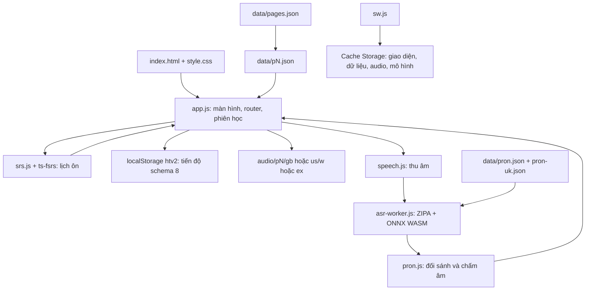

# Khảo sát Học Từ Vựng và chuẩn bị mở rộng Oxford 5000

> Đây là khảo sát baseline trước triển khai. Kết quả hiện tại và cách đếm nhãn phân biệt hoa/thường nằm trong [báo cáo phát hành](CONTENT_RELEASE_2026-10-26.md).

Ngày khảo sát: **26/10/2026**, múi giờ Asia/Saigon.

Repository: https://github.com/meiiie/hoc-tu-vung. Nhánh `main`, commit `8953b394657555ee07dd5bb32f30823829330032` (v17). Clone trực tiếp tại `E:\Sach\Sua\NekoTuVungOxford`.

Phạm vi: đọc mã nguồn, dữ liệu, tài liệu thiết kế và lịch sử phiên bản gần nhất; kiểm kê toàn bộ dữ liệu hiện có; đối chiếu danh mục Oxford; chạy unit test và kiểm tra trình duyệt; chuẩn bị trình tự mở rộng. **Chưa nhập thêm từ vào ứng dụng, chưa thay đổi thuật toán hay triển khai lên GitHub Pages.**

## 1. Kết luận

Ứng dụng có nền tảng học từ khá đầy đủ: luyện nhớ theo bốn bước, ôn FSRS/SM-2, phát âm UK/US, chấm từng âm trên thiết bị, lưu phiên và hoạt động offline. Đây là PWA tĩnh, không có backend, tài khoản đám mây hay quy trình build bằng npm.

Hiện chỉ có 252 mục của trang đầu Oxford 3000, chưa có toàn bộ 3000 hay 5000 từ. Có thể giữ kiến trúc tĩnh để mở rộng; các phần cần chuẩn bị nhất là **danh mục chuẩn, ID bền vững, nội dung có chất lượng, phiên âm/âm thanh, lưu tiến độ và cách phân phối từ mới**. Không có bằng chứng cần đổi framework hoặc thay FSRS chỉ vì tăng số lượng từ.

## 2. Nội dung hiện có

Nguồn dữ liệu chạy thật là `data/pages.json` → `data/p1.json`.

| Hạng mục | Kết quả đo |
|---|---:|
| Trang dữ liệu | 1, từ `a, an` đến `beer` |
| Mục học, ID không trùng | 252 |
| Nhãn sau khi bỏ chú thích trong ngoặc | 250 |
| Dạng từ riêng sau khi tách thêm `a, an` | 251 |
| Mục có nghĩa Việt, IPA, từ loại, cấp độ, ví dụ, bản dịch, cụm từ | 252/252 |
| Mục có mẹo học sẵn | 115 |
| Mục gắn IELTS Task 1 | 37 |
| Nhóm ngày | 10: chín nhóm 25 mục, nhóm cuối 27 |
| Tham chiếu âm vị Mỹ | 252/252 |
| Tham chiếu âm vị Anh | 251/252; `alcoholic` dùng tham chiếu Mỹ dự phòng |
| Tệp âm thanh | 1.008/1.008, tổng 14.666.688 byte |
| Ví dụ được hàm cloze hiện tại tìm thấy đáp án | 250/252 |

Hai trường hợp bỏ qua bước điền câu là `be` → “are” và `become` → “became”. Hàm hiện tại chỉ dùng so khớp và quy tắc biến đổi đơn giản, chưa có bảng động từ bất quy tắc.

Theo cấp độ thấp nhất ghi trong từng mục: A1 = 68, A2 = 71, B1 = 61, B2 = 52; chưa có C1. Nếu đếm mọi giá trị trong `cefr[]`, tổng theo cấp vượt 252 vì một mục có nhiều cấp. Tương tự, `bank` và `bear` tách nghĩa nên không được coi là dữ liệu trùng cần xóa.

Kiểm tra này xác nhận tính đầy đủ cấu trúc, đường dẫn tài nguyên và một số ví dụ nội dung. Nó **không chứng nhận toàn bộ 252 bản dịch, câu ví dụ và mức CEFR đều chính xác về ngôn ngữ**. Cần rà soát biên tập riêng khi chuẩn hóa bộ mới.

## 3. Kiến trúc và luồng dữ liệu

| Thành phần | Trách nhiệm / vị trí đáng đọc |
|---|---|
| `index.html`, `style.css` | Shell, SVG icon, giao diện ưu tiên điện thoại; desktop dùng cột giữa 600–720 px |
| `app.js:13` | State mặc định, schema 8, migration, backup và lưu toàn bộ state |
| `app.js:75` | Đọc tất cả trang song song, gộp thành `words`; lọc theo trang/ngày/CEFR/Task 1/sao |
| `app.js:85` | Suy đường dẫn audio từ `page` và phần số của ID |
| `app.js:309` | Flashcard tự do, lật/vuốt, trộn, lưu phiên |
| `app.js:333`, `srs.js` | Hàng đợi ôn, trả lời, khoảng cách, thẻ hai chiều và hoàn tác |
| `app.js:407` | Chế độ Học và Từ khó |
| `app.js:495` | Luyện nói; điều phối model/trình duyệt/ghi âm |
| `pron.js`, `speech.js`, `asr-worker.js` | Thu âm, đặc trưng âm thanh, nhận dạng âm vị, đối sánh, điểm từng âm |
| `artic.js`, `mascot.js` | Hình vị trí miệng, hướng dẫn phát âm, linh vật SVG và chuyển động |
| `app.js:639`, `app.js:691` | Danh sách từ, vòng đời, tìm kiếm, thống kê |
| `app.js:706` | Xuất/nhập tiến độ JSON |
| `sw.js` | Shell/dữ liệu ưu tiên mạng, fallback cache; audio cache-first, hỗ trợ Range cho Safari |

Router dùng hash như `#/review`, `#/learn`, `#/list`. Cấu trúc này phù hợp hosting tĩnh, README trỏ tới GitHub Pages. Không thấy cấu hình CI trong checkout.

Tiến độ gắn với **origin và trình duyệt**, không tự đồng bộ giữa GitHub Pages, localhost và thiết bị khác. Clone code không mang theo tiến độ học trên website; cần xuất/nhập bản sao lưu nếu muốn chuyển.

## 4. Thuật toán học đang thực thi

### Ôn theo lịch

Mặc định FSRS-6 qua bản vendored `ts-fsrs` 5.4.2. Người học chọn Lại/Khó/Được/Dễ; thuật toán cập nhật độ bền trí nhớ (`s`), độ khó (`d`), trạng thái và hạn ôn. Mức nhớ mục tiêu mặc định 90%, có lựa chọn 85% và 95%. Mã dùng trọng số mặc định của thư viện; không thấy bộ tối ưu trọng số theo lịch sử riêng của người dùng.

- Trạng thái thẻ: Mới → Đang học → Ôn; quên khi đang Ôn → Học lại.
- Bước học 1 phút, 10 phút; bước học lại 10 phút. Nút Dễ có thể đưa thẻ sang Ôn sớm hơn.
- Ưu tiên hàng đợi: thẻ đang học đã đến hạn → thẻ ôn đã đến hạn → thẻ mới trong hạn mức → thẻ đang học sắp đến hạn trong 20 phút.
- Trong thẻ mới, từ từng gặp qua luyện tập được ưu tiên. Chưa có lộ trình tự động theo tần suất hoặc CEFR; thứ tự còn lại phụ thuộc dữ liệu và bộ lọc.
- Hai chiều dùng hai record: `id` cho Anh → Việt, `id~r` cho Việt → Anh. Học một chiều thì ẩn thẻ anh em tới ngày học sau để giảm gợi ý lẫn nhau.
- Mốc ngày của lịch ôn/ẩn thẻ là 4 giờ sáng. Số câu và hạn mức mới lại dựa trên ngày lịch lúc 0 giờ; cần thống nhất trước khi chỉnh trải nghiệm học qua đêm.
- Fuzz và cân bằng tải phân tán ngày ôn, tránh ngày của thẻ anh em trong phạm vi gần. Load balancing giới hạn với khoảng cách đến 90 ngày.
- Quên 8 lần khi thẻ đang Ôn thì gắn sao và tạm ngưng; nhắc lại mỗi 4 lần quên tiếp theo nếu mở lại.
- SM-2 là lựa chọn thay thế; có chuyển trạng thái cũ sang FSRS và giữ được lịch cơ bản.

Theo router v17, **Ôn theo lịch là đường duy nhất gọi bộ lập lịch để cập nhật mô hình trí nhớ**. Trong mã vẫn còn các hàm giao diện flashcard theo lịch từ v16, nhưng không phải đường người dùng đang đi từ `cards()`.

### Chế độ Học

Mỗi từ đi qua trắc nghiệm → tự gõ từ Anh từ nghĩa Việt → điền vào câu → nghe–chép. Vòng thông thường gồm 7 từ, ưu tiên từ học dở. Trả lời đúng tăng bước, sai lùi một bước. Nếu không tạo được cloze thì bỏ qua bước đó.

Đáp án được chuẩn hóa hoa/thường, dấu câu và khoảng trắng. Hàm khoảng cách Damerau–Levenshtein chấp nhận một chỉnh sửa với từ 4–7 ký tự, hai chỉnh sửa với từ từ 8 ký tự; từ ≤3 ký tự phải khớp. “Gần đúng” vẫn tính là đạt bước. Có nút tự sửa chấm “Tôi đã đúng”.

`S.learn[id] = 4` chỉ nghĩa là đã qua các bài luyện này. Trạng thái “Thành thạo” trong danh sách lại dựa trên thẻ Ôn có độ bền ≥21 ngày (hoặc interval SM-2). Đây là hai chỉ báo khác nhau, không phải chứng nhận sử dụng từ thành thạo trong giao tiếp.

### Các chế độ còn lại và tác động tới tiến độ

| Chế độ | Hành vi |
|---|---|
| Thẻ ghi nhớ | Lướt toàn bộ bộ lọc; chọn “Đang học” đưa từ về cuối lượt |
| Từ khó | Điểm ưu tiên từ số lần sai, lapses, leech và gắn sao; luyện tối đa 12 từ một vòng |
| Nghe–chép | Tối đa 10 từ ngẫu nhiên mỗi lượt, nghe chậm, gợi ý ký tự |
| Kiểm tra | Tối đa 20 câu gõ từ / trắc nghiệm / đúng-sai; chọn ngẫu nhiên, chưa phân tầng theo CEFR |
| Ghép thẻ | Tối đa 6 cặp; sai cộng 1 giây; đúng ghi nhận tiếp xúc với từ |
| Ôn toàn bộ | Lượt riêng; Lại/Khó đưa thẻ trở lại sau vài thẻ; không ghi điểm vào FSRS |
| Luyện nói | Lưu lịch sử phát âm riêng, không dùng điểm phát âm làm điểm nhớ nghĩa |

Các bài luyện ghi bằng chứng vào `S.ev` (tối đa 40 sự kiện/từ). Thành công không tăng khoảng cách ôn. **Thất bại có thể đưa hạn ôn chiều Anh → Việt từ tương lai về ngày mai**, tối đa một lần/ngày, giữ nguyên `s`, `d`, `int`. Vì vậy dòng giao diện “không thay đổi lịch ôn” là mô tả chưa đầy đủ; chính xác hơn là “không tăng khoảng cách, có thể nhắc ôn sớm khi sai”. Đã xác nhận hành vi này trong trình duyệt.

Tài liệu `LIFECYCLE.md` nói lỗi ở flashcard cũng tăng `S.miss`, nhưng `practice()` không tăng biến này và `cards()` cũng không làm việc đó. Thử nghiệm trả về `missCounter = 0`. Học/Nghe–chép/Kiểm tra tăng biến ở call site riêng. Cần đồng bộ chính sách khi chỉnh phần này.

### Phát âm

Thu âm → mono 16 kHz → 80-bin fbank → ZIPA int8 chạy trong Web Worker bằng ONNX Runtime WASM → CTC → đối sánh với các biến thể âm vị → điểm từng âm và gợi ý cho người Việt. CMUdict cung cấp tham chiếu Mỹ, Britfone cung cấp tham chiếu Anh; chế độ Anh vẫn chấp nhận biến thể Mỹ. Trọng âm chỉ được ước lượng theo âm lượng/thời lượng.

Mô hình khoảng 71 MB tải theo yêu cầu và lưu cache; audio mẫu là MP3 tạo sẵn, không sinh TTS lúc chạy. Khi dùng Web Speech fallback, điểm dựa trên nhận dạng cả từ. Vì vậy hai chế độ chấm không có cùng ý nghĩa. Các số liệu độ chính xác trong `PRONUNCIATION.md` là báo cáo trước đó của dự án; khảo sát này chỉ chạy fixture chấm âm, chưa đo lại model với giọng người thật hoặc iPhone.

## 5. Đối chiếu danh mục Oxford và định nghĩa “đủ 5000”

[Oxford giải thích](https://www.oxfordlearnersdictionaries.com/about/wordlists/oxford3000-5000): bộ 5000 mở rộng từ 3000 từ cốt lõi A1–B2 bằng 2000 từ bổ sung dành cho B2–C1. Vì thế không được lấy riêng PDF “Oxford 5000” chứa phần bổ sung rồi coi là toàn bộ bộ học.

Đã đọc HTML công khai của [danh mục chính thức](https://www.oxfordlearnersdictionaries.com/wordlists/oxford3000-5000). Snapshot ngày khảo sát có 5.975 dòng `li[data-hw]` và 4.957 nhãn `data-hw` khác nhau. Dòng chia theo từ loại/biến thể, trong khi nhiều từ đồng hình dùng cùng nhãn. **Đây là số đếm theo cấu trúc HTML, không phải kết luận Oxford thiếu 43 từ.** Không được dùng riêng `Set(word)` hoặc tổng dòng để chứng minh hoàn thành danh mục.

Sau khi tách `a, an` và bỏ chú thích nghĩa trong ngoặc, 251 nhãn của dữ liệu hiện có đều xuất hiện trong snapshot; còn 4.706 nhãn chính thức chưa có. So khớp này mới ở mức nhãn, chưa chứng minh đủ từng từ loại và từng nghĩa.

Cần thêm từ ngay trong A–B, ví dụ `abolish`, `absence`, `absorb`, `academy`. Chỉ bổ sung các từ sau `beer` sẽ bỏ sót phần mở rộng trước đó.

Đề xuất hợp đồng kiểm đếm trước khi nhập:

1. Manifest tham chiếu ghi nguồn, phiên bản/ngày lấy, headword, từ loại, cấp độ, định danh từ điển và biến thể; phân biệt Oxford 3000 với phần mở rộng.
2. Báo cáo riêng: độ phủ danh mục nguồn; số mục học; số headword; số nghĩa; số thẻ ôn. Hai chiều không được làm tăng số từ được quảng bá.
3. Giữ nguyên `p1-001`…`p1-252`. Các mục tách/gộp mới cần mapping tới nguồn; không renumber để xếp lại A–Z. Với `a, an`, chuẩn bị quy tắc chia tiến độ nếu quyết định tách.
4. Nếu sản phẩm cần **đúng 5.000 mục học**, chốt cách gộp/tách nghĩa hợp lý và báo cáo riêng độ phủ Oxford. Không thêm mục trùng hoặc đếm thẻ đảo chiều để làm đủ con số.

## 6. Các điểm cần xử lý trước khi đưa bộ lớn vào dùng

| Mức ưu tiên | Bằng chứng và ảnh hưởng | Chuẩn bị cần làm |
|---|---|---|
| Cao | `save()` stringify toàn bộ tiến độ vào `localStorage`, còn có bản dự phòng; `importProgress()` từ chối file >5 MB | Lưu tiến độ chính trong IndexedDB hoặc thiết kế lưu đủ dung lượng có migration; cập nhật nhập/xuất; kiểm tra lỗi quota và khôi phục |
| Cao | Giả lập 5.000 mục / 10.000 thẻ, 40 evidence + 12 lần nói mỗi từ, 20.000 review log: state compact 8.420.384 byte, `QuotaExceededError` trên Chromium thử nghiệm | Dùng tình huống này làm điều kiện nghiệm thu; không coi đây là dung lượng ngay sau khi thêm từ |
| Cao | Không có nút lọc C1 ở `openFilter()`; mặc định từ mới/ngày là “Tất cả” | Thêm C1; đề xuất mặc định 10–25 từ/ngày cho người mới, bảo toàn lựa chọn của người dùng cũ; ưu tiên ôn đến hạn |
| Cao | Audio suy từ ID; hai script phiên âm hardcode `p1.json` và đường dẫn Linux | Tạo công cụ đầu vào/đầu ra rõ ràng cho mọi trang, có báo cáo từ thiếu và ngoại lệ; kiểm tra đủ 4 audio/mục, không trỏ vào file không tồn tại |
| Cao | `loadData()` cần mọi trang thành công; precache mới chỉ liệt kê `p1.json` | Cập nhật manifest, shell/cache và phiên bản khi thêm trang; kiểm tra lần cài mới, nâng cấp và offline |
| Vừa | Quy đổi âm thanh hiện tại lên 5.000 mục ≈291 MB cho cả hai giọng, chưa tính model/runtime | Tải theo phần/giọng, báo dung lượng và số tệp thực sự thành công; hiện nút tải hết báo thành công cả khi request lỗi |
| Vừa | Danh sách render toàn bộ; `byId()` dùng tìm tuyến tính; phiên flashcard lưu hàng đợi/lịch sử tăng dần | Đo trên điện thoại, chỉ thêm phân trang/lập chỉ mục ở chỗ cần; kiểm tra thời gian lưu/khôi phục phiên dài |
| Vừa | Mục tiêu “từ mới” thực tế đếm card; ngày lịch 0h khác mốc scheduler 4h | Thống nhất đơn vị và ranh giới ngày; 5.000 mục có thể sinh 10.000 thẻ |
| Vừa | Metadata gom nhiều nghĩa/POS vào một thẻ, cloze theo stem, trắc nghiệm lấy distractor từ toàn bộ kho | Rà soát tính mơ hồ, dạng bất quy tắc, đáp án đồng nghĩa; chọn distractor không vô tình cũng đúng |
| Vừa | Dữ liệu nhiều cấp, nhiều nghĩa; bước Học và “Thành thạo” là hai chỉ báo | Diễn đạt tiến độ rõ, không hứa CEFR/IELTS chỉ từ số thẻ hoàn thành |

Thử nghiệm danh sách 5.000 mục giả lập render đủ 5.000 hàng, khoảng 228 ms cho lời gọi `list()` trên máy desktop này. Số này không bao gồm toàn bộ tải mạng/paint hay mô phỏng CPU điện thoại, nên chưa phải xác nhận hiệu năng mobile.

## 7. Trình tự mở rộng đề xuất

1. **Chốt manifest và mapping.** Đối chiếu cả Oxford 3000 + phần mở rộng; phân loại những mục hiện có theo nguồn. Giữ ID cũ và xác định riêng số mục còn thiếu.
2. **Chuẩn bị lưu trữ và nạp dữ liệu.** Migration tiến độ, sao lưu/khôi phục, C1, giới hạn từ mới, chuẩn hóa ngày và đơn vị đếm. Giữ FSRS hiện tại.
3. **Thí điểm một lô nhỏ, khoảng 100–250 mục.** Bao gồm C1, từ nhiều nghĩa, từ bất quy tắc và từ nhiều từ loại để kiểm tra schema và mọi chế độ.
4. **Biên soạn nội dung theo lô.** Mỗi mục có nghĩa Việt đúng nghĩa được học, IPA phù hợp, ví dụ tự biên soạn và bản dịch, collocation, đáp án cloze/biến thể chấp nhận được. Lưu provenance và tình trạng review. Không nhân bản câu ví dụ để lấp đủ số lượng.
5. **Hoàn thiện phát âm.** Sinh âm vị US/UK, xử lý ngoại lệ, tạo audio từ/câu và kiểm tra nghe mẫu. Model ZIPA không cần đổi chỉ vì có thêm từ; phần cần tăng là dữ liệu tham chiếu.
6. **Đưa đủ danh mục vào app rồi nghiệm thu.** Báo cáo số thiếu/trùng theo mapping; kiểm tra tài nguyên, từ loại/CEFR, migration từ v17, offline, Range audio, F5, hoàn tác, hai chiều, ngày mới, quota và nhập lại backup lớn.

Tiêu chí kết thúc: đủ phạm vi đã thống nhất và từng mục học có thể dùng được trong các chế độ; tiến độ cũ giữ nguyên; không mất dữ liệu trong tình huống dùng lâu dài. Không lấy việc JSON có đủ số dòng làm tiêu chí duy nhất.

## 8. 5.000 từ có đủ để học chưa?

**Đủ làm mục tiêu nền tảng rất đáng học, nhưng không phải đích cuối của năng lực tiếng Anh.** Đề xuất của khảo sát là dùng bộ này làm chương trình từ vựng cốt lõi, đồng thời luyện nghe, đọc, nói, viết ngay từ đầu. Người học không cần đợi thuộc hết danh sách mới sử dụng tiếng Anh.

Nhãn A1–C1 của từng mục từ không có nghĩa học xong danh sách tự động đạt C1 hay một band IELTS cụ thể. Cần biết nhiều nghĩa, kết hợp từ, cấu trúc, phát âm và dùng từ đúng trong tình huống thực tế; nhận ra đáp án khác với tự dùng được từ.

[Nation (2006), How Large a Vocabulary Is Needed for Reading and Listening?](https://doi.org/10.3138/cmlr.63.1.59) ước tính với giả định độ bao phủ 98% để hiểu không trợ giúp, ngữ liệu viết cần khoảng 8.000–9.000 **word families**, ngữ liệu nói khoảng 6.000–7.000. Đây là kết quả theo corpus và đơn vị họ từ, không thể quy trực tiếp thành số headword/mục học Oxford; cũng không phải bảo đảm hiểu 98% nội dung. Trong khảo sát này dùng kết luận từ abstract của bài, không khẳng định đã đọc toàn văn qua DOI.

Gợi ý vận hành: học 10–20 mục mới mỗi ngày tùy lượng ôn còn lại; ôn đến hạn trước; chọn bài đọc/nghe phù hợp và tự đặt câu với từ vừa học. 5.000 mục ở 20 mục/ngày tương đương tối thiểu 250 ngày giới thiệu từ mới nếu bắt đầu từ số không, **chưa tính** ngày nghỉ, lượt ôn và thời gian dùng thành thạo.

## 9. Kiểm chứng đã thực hiện và giới hạn

- Scheduler: **23 test đạt**, so với package `ts-fsrs@5.4.2` độc lập đặt trong thư mục tạm.
- Scorer: **9 test đạt**, dùng logits fixture có sẵn; không phải thử model trên người thật.
- Mascot: đạt **108 cặp tương phản**, kiểm tra các trạng thái yêu cầu trong 21 trạng thái.
- Cú pháp `app.js`, `sw.js`: đạt `node --check`.
- Playwright Chromium, viewport 390×844, timezone Asia/Ho_Chi_Minh: onboarding, 252 mục/504 thẻ, review Good, ẩn thẻ anh em, F5, undo, 10 màn hình chế độ khác, tìm kiếm, offline shell/dữ liệu, migration giữ đủ 40 record từ schema 7→8; không có `pageerror`.
- Xác minh policy luyện tập: thành công giữ lịch; thất bại đưa hạn về ngày mai và giữ `s/d/int`; flashcard không tăng `miss`.
- Đo tải dữ liệu giả lập 5.000 mục trong context trình duyệt dùng một lần; không ghi dữ liệu giả vào repository hay trình duyệt người dùng.

Lưu ý môi trường Windows: Git hệ thống dùng `core.autocrlf=true`, khiến `vendor/zipa-tokens.txt` thành CRLF; regex đọc token trong test và worker không chấp nhận phần CR còn lại. Đã đặt `core.autocrlf=input` **chỉ cho repository này** và khôi phục đúng bytes LF của file từ HEAD. Hash blob trước/sau giống nhau, không đổi nội dung nguồn. Nên có quy tắc LF hoặc parser chấp nhận CRLF trong đợt chỉnh công cụ sau.

Các script Playwright cũ trong repository phụ thuộc đường dẫn Linux và snapshot v5/v6 nên không chạy nguyên xi trên Windows. Đã dùng harness tạm riêng. Harness ban đầu gặp nghẽn pipe log của server và lỗi console encoding khi in tiếng Việt; dữ liệu kiểm tra được ghi UTF-8 và đã xác nhận kết quả sau khi khắc phục môi trường. Không coi các lỗi harness này là lỗi sản phẩm.

Chưa kiểm tra micro thật, chạy trọn model ZIPA, thiết bị iPhone thật, toàn bộ audio bằng nghe thủ công, hay chất lượng ngôn ngữ của hàng nghìn mục chưa được biên soạn. Chưa xác minh trạng thái website production; kết quả ở trên áp dụng cho checkout tại commit đã ghi.
