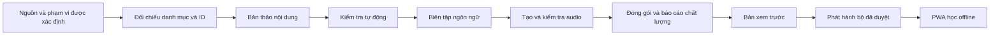

# Đưa bộ từ vựng lên quy mô 5.000: thiết kế dữ liệu và vận hành

**Ngày chốt nghiên cứu: 26-10-2026. Trạng thái: đề xuất sau khảo sát, chưa triển khai và chưa nhập thêm từ.**

Phạm vi mã nguồn: `meiiie/hoc-tu-vung`, commit `8953b394657555ee07dd5bb32f30823829330032`. [Báo cáo hiện trạng](PROJECT_AUDIT_5000.md), [bằng chứng khảo sát](audits/2026-10-26-baseline.json), [nguồn nghiên cứu và giới hạn](research/2026-10-26/SOURCES.md), [nhật ký quyết định](research/2026-10-26/decisions.tsv).

## 1. Quyết định đề xuất

Giữ ứng dụng học dạng PWA chạy tĩnh, bổ sung **quy trình sản xuất nội dung có kiểm định**, **bản phát hành dữ liệu bất biến** và **lưu tiến độ bằng IndexedDB có migration**. Tách ba việc này để có thể sửa dữ liệu, cập nhật ứng dụng hoặc đánh giá thuật toán mà không vô tình thay đổi hai phần còn lại.

Giả định làm việc: bộ tiếng Anh cho người học Việt, lấy phạm vi Oxford 3000 + phần mở rộng làm mốc đối chiếu, phục vụ học cá nhân và offline; nội dung IELTS hiện có là một lựa chọn chủ đề. Nếu cần tài khoản, nhiều thiết bị hoặc nhiều biên tập viên đồng thời, đó là yêu cầu bổ sung làm thay đổi phương án vận hành.

Nền tảng hiện tại đáng giữ: scheduler thuần trong `srs.js`, bài tập nhiều hình thức, hai chiều ôn, phát âm offline và giao diện học đã hoạt động. Tuy nhiên, kết quả kiểm tra kỹ thuật trước đó chưa chứng nhận chất lượng ngôn ngữ của từng mục hoặc độ bền trên mọi thiết bị. Chưa thể gọi bản hiện tại là sẵn sàng production cho việc sử dụng dài hạn với bộ đầy đủ.

| Phương án | Lợi ích | Đánh đổi | Kết luận |
|---|---|---|---|
| Bổ sung JSON/audio vào cấu trúc hiện tại | Ít thay đổi, đưa dữ liệu lên nhanh | Chưa giải quyết lưu tiến độ, định danh nghĩa, kiểm định và cập nhật nhiều gói | Chỉ phù hợp bản thử nhỏ |
| Công cụ biên soạn riêng + bộ dữ liệu đã duyệt + PWA offline | Kiểm soát chất lượng, chạy rẻ, dễ tái dựng và khôi phục | Cần đầu tư schema, migration, kiểm thử lỗi và công sức biên tập | **Chọn cho giai đoạn 5.000 từ** |
| Backend nội dung, tài khoản, đồng bộ và sinh bài bằng AI khi học | Hỗ trợ nhiều biên tập viên, nhiều thiết bị, nội dung động | Thêm vận hành, bảo mật, chi phí, xử lý xung đột và phụ thuộc mạng | Chỉ mở khi có nhu cầu thực tế rõ ràng |

Không chọn công nghệ theo danh tiếng của lab. Áp dụng những thực hành có thể kiểm chứng: tài liệu dữ liệu của Google, đánh giá nhiều lớp của Anthropic, thử lại có định danh của AWS và phát hành có đối chứng/khôi phục của Google SRE. Đây là vận dụng vào dự án, không phải chứng nhận của các tổ chức đó. [Google Data Cards](https://research.google/blog/the-data-cards-playbook-a-toolkit-for-transparency-in-dataset-documentation/), [Anthropic evals](https://www.anthropic.com/engineering/demystifying-evals-for-ai-agents), [AWS idempotency](https://aws.amazon.com/builders-library/making-retries-safe-with-idempotent-APIs/), [Google SRE](https://sre.google/workbook/canarying-releases/).

## 2. Điều nghiên cứu thực sự cho phép kết luận

**Một bộ từ là chương trình nội dung, không phải giấy chứng nhận trình độ.** Oxford 5000 gồm Oxford 3000 và 2.000 từ mở rộng B2–C1. Chính Oxford lưu ý rằng một từ còn có nhiều nghĩa và cách dùng cần học. Vì vậy 5.000 là mục tiêu nền tảng tốt, nhưng hoàn thành thẻ không đồng nghĩa đạt C1, IELTS hoặc sử dụng thành thạo trong giao tiếp. [Oxford](https://www.oxfordlearnersdictionaries.com/about/wordlists/oxford3000-5000).

**CEFR cần gắn với nghĩa và nhiệm vụ học.** English Vocabulary Profile phân biệt nghĩa, cụm từ và mức độ. Một ví dụ có từ đích A1 vẫn có thể khó đối với người mới. Nghiên cứu công bố 24-09-2026 về phân loại độ khó CEFR cũng báo cáo prompting biến động và sự cần thiết của dữ liệu gán nhãn thủ công cân bằng. Với bài 2026 này, mới xác minh được metadata và abstract ở kho Đại học Barcelona; PDF tải lỗi, nên không dùng các con số hiệu năng hay khẳng định chi tiết chưa đọc. [EVP](https://englishprofile.org/?menu=english-vocabulary-profile), [nghiên cứu CEFR 2026](https://diposit.ub.edu/items/3f4ce6f8-07a1-4b94-9742-59884dcab227/full).

**Ngữ cảnh có ích, nhưng kết quả nhỏ không phải cam kết cho sản phẩm.** Bài BEA 2024 thử 26 người học tiếng Đan Mạch trong 10 ngày; hướng dùng câu có triển vọng, song mẫu thuận tiện, thời gian ngắn và nhiều phép so sánh làm giới hạn suy rộng. Bài ACL-SRW 2024 về tiếng Nhật tìm thấy ưu thế của truy hồi ví dụ trong thiết lập được thử; kết quả đó không chứng minh mọi LLM năm 2026 đều kém hơn truy hồi. Suy ra cho dự án: cần ngân hàng ví dụ đã duyệt, đánh giá riêng độ đúng nghĩa, độ khó và tính tự nhiên. [BEA 2024](https://aclanthology.org/2024.bea-1.29/), [ACL-SRW 2024](https://aclanthology.org/2024.acl-srw.55/).

**Ôn cũ cần đi cùng học mới.** Nghiên cứu TESOL Quarterly 2025 trên hai lớp, 44 người mỗi nhóm, cho thấy lợi ích kiểm tra tích lũy phụ thuộc mức luyện tập và năng lực ban đầu. Đây là cơ sở tham khảo để ưu tiên ôn đến hạn và đo việc nhớ sau một thời gian; không suy ra một lịch ôn cố định tối ưu cho tất cả. [Maie và cộng sự, 2025](https://doi.org/10.1002/tesq.3391).

**FSRS-6 hiện tại không phải phiên bản mới nhất theo nguồn đã kiểm tra.** README benchmark SRS tại commit `bd9110f`, ngày 18-09-2026, đã có FSRS-7, SBD và các mô hình neural. Benchmark đo dự đoán nhớ bằng Log Loss, AUC, RMSE; RWKV dùng thêm đặc trưng và cách chia dữ liệu khác một số mô hình. Không thể lấy vị trí trên bảng làm bằng chứng người học Việt Nam sẽ học tốt hơn. Đề xuất giữ FSRS-6 khi đổi dữ liệu/lưu trữ, rồi đánh giá nâng scheduler riêng bằng lịch sử đã chuẩn hóa và kiểm tra hành vi. [Snapshot benchmark](https://github.com/open-spaced-repetition/srs-benchmark/blob/bd9110f791e5b37282c55a9aa8db35f68f0c4aa2/README.md).

**JSON đúng schema chỉ chứng minh hình dạng dữ liệu.** Structured Outputs vẫn có thể chứa giá trị sai. AI chấm AI cần hiệu chuẩn với đánh giá của người có chuyên môn. Vì vậy kết quả được sinh phải đi vào khu chờ duyệt; trạng thái kiểm tra bằng máy không được đổi tên thành đã được biên tập viên xác nhận. [OpenAI](https://openai.com/index/introducing-structured-outputs-in-the-api/), [Anthropic](https://www.anthropic.com/engineering/demystifying-evals-for-ai-agents).

## 3. Những bằng chứng trong repo quyết định thiết kế

| Hiện trạng đã kiểm tra | Hệ quả đối với bộ đầy đủ |
|---|---|
| 252 mục ở `data/p1.json`; một mục có thể gom nghĩa và nhiều từ loại | Không dùng số hàng JSON làm số từ/độ phủ duy nhất |
| `p1-013` gom `access` danh từ và động từ, có tip “Luôn đi với to” | Cần biên tập lại phạm vi của quy tắc; danh từ có mẫu `access to`, động từ ngoại động có tân ngữ trực tiếp. Không tự áp dụng một tip cho mọi nghĩa/POS. [Cambridge](https://dictionary.cambridge.org/dictionary/english/access) |
| `p1-001` gắn A1 nhưng ví dụ dùng ngữ cảnh mô tả biểu đồ | Cấp độ từ đích và độ khó câu là hai trường riêng; cần ví dụ cơ bản trước ví dụ chuyên biệt |
| Cloze hiện không nhận `be → are`, `become → became` trong ví dụ tương ứng | Lưu vị trí từ đích và dạng đáp án rõ ràng; không chỉ đoán bằng chuỗi/stem |
| ID là khóa tiến độ; audio suy từ page và phần số trong ID | Giữ ID cũ; tách danh tính mục học khỏi vị trí file và thứ tự hiển thị |
| `save()` ghi toàn bộ state vào localStorage; import giới hạn 5 MB | Cần kho lưu tiến độ và cơ chế backup chịu được lịch sử dài |
| Bài thử tổng hợp đã tạo state 8.420.384 byte và gặp lỗi quota | Là bằng chứng rủi ro tích lũy, không phải nói thêm 5.000 từ là lập tức mất dữ liệu |
| Tải dữ liệu cần tất cả trang thành công; SW hardcode p1 và dùng network-first | Cần bản phát hành nhất quán và tiếp tục dùng bản đã xác minh khi cập nhật lỗi |
| Filter chưa có C1; giới hạn từ mới thực tế đếm thẻ | Chốt đơn vị hiển thị và hàng đợi trước khi tăng kho |

Hai ví dụ nội dung trên là phát hiện cục bộ, không phải kết quả kiểm duyệt ngôn ngữ toàn bộ 252 mục. Mọi mục cũ vẫn cần trạng thái chất lượng trung thực.

## 4. Mô hình miền và định danh

Các khái niệm phải phân biệt trong dữ liệu; không bắt buộc biến mỗi khái niệm thành một bảng, service hoặc lớp kế thừa.

| Khái niệm | Trách nhiệm | Điều không được suy ra |
|---|---|---|
| Lexeme / từ gốc | Định danh từ, cách viết, biến thể, khóa tham chiếu nguồn | Hai chuỗi giống nhau luôn cùng từ hoặc cùng nghĩa |
| Sense / nghĩa | Từ loại, nghĩa Việt, cách dùng, nhãn CEFR kèm nguồn và trạng thái duyệt | Một nhãn CEFR của từ áp dụng cho tất cả nghĩa |
| Learning item / mục học | Mục tiêu kiến thức cụ thể, liên kết nghĩa hoặc nhóm nghĩa cũ được giữ lại | Một mục học luôn bằng một dòng của danh mục nguồn |
| Example / ví dụ | Câu, bản dịch, nghĩa được minh họa, độ khó, vị trí từ đích | Có chứa từ là minh họa đúng nghĩa |
| Exercise / bài tập | Kiểu hỏi, đáp án, dạng chấp nhận, câu hỏi và phương án nhiễu | Có thể dùng mọi biến thể của từ cho mọi câu |
| Card / thẻ ôn | Mục học + chiều/kỹ năng được lên lịch | Hai thẻ xuôi/ngược là hai từ |
| Audio / phát âm | Văn bản đọc, giọng US/UK, phiên bản tạo, file và hash | Cùng chữ viết luôn cùng cách phát âm |
| Review event / lượt ôn | Định danh lần trả lời, thời gian, rating, card, revision nội dung, phiên bản scheduler | Nhìn thấy câu hoặc trả lời trắc nghiệm là đã tự nhớ cả câu |

**Quy tắc tương thích:** giữ nguyên `p1-001`…`p1-252` và khóa đảo chiều hiện có. Mã mới cấp một lần, không tạo lại từ số thứ tự, spelling hoặc vị trí trang. Catalog ánh xạ ID tới pack và audio; file có thể đổi chỗ mà tiến độ vẫn tìm đúng mục.

Sửa lỗi chính tả, bản dịch hoặc thay câu cùng mục tiêu: tăng revision nội dung, giữ lịch ôn. Thay mục tiêu nghĩa: tạo mục mới hoặc đánh dấu chuyển đổi cần xem xét. Khi tách một mục cũ thành hai nghĩa, giữ bằng chứng cũ liên kết mục gốc, không tự sao chép “thành thạo” sang cả hai. Mục bị rút vẫn có tombstone để đọc được backup và lịch sử; không tái sử dụng ID.

Ví dụ hợp đồng cloze đề xuất cho câu tự biên soạn, chỉ minh họa cấu trúc:

```json
{
  "exampleId": "example-become-01",
  "learningItemId": "p1-247",
  "text": "She became a teacher.",
  "translationVi": "Cô ấy đã trở thành giáo viên.",
  "target": { "start": 4, "end": 10, "surface": "became" },
  "cloze": { "acceptedAnswers": ["became"] },
  "reviewState": "draft"
}
```

Hợp đồng phải quy định rõ offset là UTF-16 theo JavaScript, end-exclusive và tính sau chuẩn hóa NFC. Validator kiểm tra `text.slice(start, end) === surface`. `become` và `becomes` không được tự nhận là đúng chỉ vì cùng lemma. Với từ xuất hiện nhiều lần, chỉ đích danh occurrence; với cụm có thể tách, cần span phù hợp hoặc chọn loại bài khác. Ví dụ này chưa phải dữ liệu học được duyệt.

Tách bốn phiên bản: schema nội dung, release nội dung, schema tiến độ và scheduler/model. Không dùng một số version để đại diện cả bốn.

## 5. Quy trình đưa dữ liệu vào



1. **Xác lập phạm vi nguồn.** Manifest tham chiếu cần source ID/URL, ngày hoặc revision, hash snapshot, cách đếm, từ loại, biến thể và điều kiện sử dụng được ghi nhận. Nguồn công khai truy cập được không tự trở thành nguồn được phép sao chép toàn bộ định nghĩa, ví dụ và audio. Ưu tiên ví dụ/bản dịch tự biên soạn; tài nguyên nhập từ bên ngoài phải có bằng chứng quyền dùng phù hợp trước khi phát hành.
2. **Đối chiếu toàn danh mục.** Tạo mapping đã kiểm tra giữa mục nguồn và mục học, gồm cả các từ còn thiếu trong A–B. Không giả định chỉ nối tiếp sau `beer`. Báo riêng mục còn thiếu, trùng, gộp, tách, ngoại lệ và nguồn không khớp.
3. **Sinh hoặc viết bản thảo theo từng nghĩa.** Đầu vào gồm nghĩa đích, POS, trình độ người học, mẫu dùng và các ràng buộc; đầu ra có schema. AI được phép báo thiếu bằng chứng hoặc không chắc. Nội dung được tham khảo là dữ liệu, không phải chỉ dẫn để chạy lệnh hoặc lấy bí mật.
4. **Kiểm tra bằng máy.** Schema, liên kết ID, trường bắt buộc, dạng từ, đáp án, vị trí cloze, ký tự Unicode, audio metadata, số lượng và provenance. Lỗi phải ghi ID và trường bị lỗi để sửa. Khi nhập CSV/nguồn khác cần adapter chuẩn hóa riêng; mô hình miền không biết định dạng của từng nhà cung cấp.
5. **Biên tập ngôn ngữ.** Người có năng lực Anh–Việt kiểm tra nghĩa, ví dụ, bản dịch, cách kết hợp từ, CEFR và khả năng trả lời bài. Các trường “đã duyệt bởi người” phải có người thật và thời điểm; nếu chưa có, giữ `pending`, kể cả khi nhiều model đồng ý.
6. **Tạo audio sau khi văn bản ổn định.** Khóa công việc theo hash văn bản đã chuẩn hóa + dialect + voice/model revision + cấu hình. Lưu file, dung lượng, hash và nguồn tạo; kiểm tra giải mã, độ dài, clipping/im lặng và nghe rà soát. ASR hỗ trợ tìm lỗi, không tự chứng nhận đúng âm hoặc trọng âm. Với từ đổi âm theo nghĩa/POS, cần xử lý riêng.
7. **Đóng gói và xem trước.** Chỉ compiler được sinh artifact runtime từ nội dung chuẩn. Mọi thay đổi phải nhìn thấy trong diff, có báo cáo tác động và xem được bài học như người dùng sẽ thấy.
8. **Phát hành và tiếp nhận sửa lỗi.** Gắn release ID; có bản trước để quay lại, cách báo lỗi theo item ID/revision và lịch sử sửa nội dung.

Các trạng thái tối thiểu: `draft → machine_checked → editorial_approved → release_ready`. Trường hợp chưa rõ đưa sang `needs_review`, không bỏ qua vì cần đủ số lượng. Với dữ liệu cũ, dùng trạng thái như `legacy_unverified` nếu chưa có chứng cứ duyệt; không gán nhãn “approved” hàng loạt.

Tách quyền biên soạn và xuất bản trong quy trình: LLM tạo bản thảo không được tự ghi trạng thái duyệt hoặc đưa file vào nhánh phát hành. Một lệnh kiểm tra bắt buộc chặn build nếu mục mới chưa đạt điều kiện. Chưa có biên tập viên không ngăn chuẩn bị pipeline và bản thảo; đó là điều kiện chưa đạt để gọi nội dung là đã kiểm duyệt và phát hành rộng.

## 6. Kiểm định nhiều lớp và bộ chuẩn

| Lớp | Kiểm tra | Điều kiện đưa tiếp |
|---|---|---|
| Cấu trúc | Schema, kiểu, ID, enum, nguồn, liên kết | Tất cả kiểm tra bắt buộc qua; không dùng cảnh báo để che lỗi chặn |
| Ngôn ngữ | Nghĩa/POS khớp, câu tự nhiên, dịch không thêm/bớt ý, hướng dẫn đúng phạm vi | Có quyết định biên tập; bất đồng được giải quyết hoặc giữ chờ |
| Bài tập | Đáp án hợp lệ, không lộ đáp án, cloze đúng dạng, trắc nghiệm không nhiều đáp án đúng | Kiểm tra tự động cộng rà soát nội dung |
| Âm thanh | Đúng từ/câu/giọng, có thể phát, hash và mapping đúng | Đạt kiểm tra kỹ thuật và duyệt phát âm theo rubric |
| Sản phẩm | Nạp, tìm, lọc C1, học, ôn hai chiều, hoàn tác, backup, cập nhật và offline | Các hành vi quan trọng qua trên ma trận môi trường đã công bố |

Không gộp mọi lỗi thành “đạt 95%”. Sai nghĩa, sai đáp án, audio trỏ nhầm và mất tiến độ là lỗi chặn. Một điểm trung bình cao không bù được những lỗi đó. Việc không phát hiện lỗi trong mẫu cũng không chứng minh không có lỗi trong cả bộ.

Đề xuất bắt đầu với **200 mục chuẩn** để đánh giá công cụ sinh/chấm: phân tầng theo A1–C1, từ loại, đa nghĩa, bất quy tắc, cụm, từ chức năng và biến thể giọng; ghi cả lỗi có chủ ý để thử khả năng phát hiện. Chia theo nhóm lexeme trước khi tinh chỉnh prompt, giữ một tập kiểm tra kín; không dùng các nghĩa/câu gần trùng của cùng từ ở cả hai phía. 200 là ngân sách khởi đầu để tìm lỗi và hiệu chuẩn rubric, chưa phải cỡ mẫu đủ để chứng minh độ chính xác hiếm lỗi.

Rubric chấm từng chiều riêng. So model judge với nhãn người và kiểm tra cả false accept lẫn false reject, đặc biệt lỗi nghiêm trọng lọt qua. Ghi kết quả theo nhóm trình độ/POS và khoảng bất định khi báo tỷ lệ. Khi đổi model, prompt, nguồn hoặc rubric, chạy lại cả bộ kiểm tra khả năng và bộ hồi quy. Chọn model theo chất lượng thực đo trên công việc này, chi phí cho một mục được chấp nhận và thời gian sửa; không mặc định model mới nhất là tốt nhất.

Pilot nội dung đề xuất 100–250 mục, cố ý chứa những ca khó. Giai đoạn đầu duyệt người từng mục mới; hiệu chuẩn chéo trên một phần mẫu khi có thêm biên tập viên. Chỉ giảm mức duyệt thường quy sau khi có dữ liệu sai sót thực tế và một quyết định được ghi lại. Các cỡ lô này là lựa chọn vận hành của dự án, không phải kết quả SOTA hoặc con số tối ưu đã được chứng minh.

## 7. Kiến trúc mã nguồn vừa đủ

Đề xuất giữ JavaScript runtime và `srs.js` thuần. Công cụ nội dung chạy cục bộ/CI bằng Node với dependency đã khóa; ưu tiên JavaScript module + JSDoc/schema để phù hợp repo trước khi cần TypeScript. Không chuyển toàn frontend sang framework chỉ để nhập dữ liệu.

Các module dưới đây là **vị trí dự kiến, chưa được tạo**:

| Vị trí dự kiến | Ranh giới trách nhiệm |
|---|---|
| `content/schema/` | Hợp đồng nội dung có version; schema chuẩn độc lập subset schema của nhà cung cấp AI |
| `content/curated/` | Nguồn sự thật cho nội dung đã biên tập; JSON dễ review, phân nhóm để diff vừa đọc |
| `content/sources/`, `content/mappings/` | Metadata nguồn, bằng chứng quyền dùng, đối chiếu và ID cũ |
| `tools/content/` | Import, normalize, validate, báo cáo, tạo audio có resume, build release; adapter I/O ở ngoài logic thuần |
| `content/evals/` | Rubric và fixture; tập đánh giá kín được quản lý riêng nếu cần giữ kín khỏi pipeline sinh |
| `data/releases/<release-id>/` | Artifact sinh tự động, manifest, packs và bảng ánh xạ tài nguyên |
| `storage.js` | Repository tiến độ, transaction, migration và backup |
| `catalog.js` | Manifest, chỉ mục ID, lấy pack, ánh xạ item/audio |
| `srs.js` | Quyết định lịch ôn thuần; không đọc DOM, mạng hoặc IndexedDB |
| `app.js`, `sw.js` | Điều phối giao diện và phục vụ offline theo hợp đồng đã tách |

Chỉ tách thêm module khi có trách nhiệm và kiểm thử hành vi riêng. Không dùng một thư mục `utils` chứa lẫn nghiệp vụ, không tạo lớp trừu tượng cho mọi hàm. Lời gọi dùng tên đầy đủ ở ranh giới: `commitReview`, `getLearningItem`, `installContentRelease`; lỗi có kiểu/kết quả cụ thể như `storage_full`, `release_incompatible`, `missing_audio`.

JSON Schema là kiểm tra lúc chạy, JSDoc/TypeScript là kiểm tra lúc phát triển; không thay thế nhau. CI chạy validator và kiểm thử trước phát hành. Bản release được build từ dữ liệu đã duyệt, không gọi LLM ngẫu nhiên trong build production.

Compiler sắp xếp ổn định, chuẩn hóa encoding và tạo manifest hash. Cùng đầu vào đã lưu và cùng toolchain phải tạo cùng artifact. Thời điểm build và log vận hành đặt ngoài phần hash xác định danh tính. Kết quả LLM/TTS cần được lưu lại: gọi lại cùng prompt hoặc seed chưa bảo đảm nhà cung cấp trả byte giống hệt.

Job import/TTS có trạng thái và checkpoint theo mục; thử lại có giới hạn, timeout và backoff. Khóa cùng yêu cầu nhưng payload khác phải báo xung đột. Chạy lại không nhân đôi mục hay ghi đè nội dung đã duyệt bằng bản thảo. Với tác vụ sinh nội dung mới có chủ ý, cấp run ID mới và lưu candidate riêng. Đây là cách áp dụng nguyên tắc idempotency vào pipeline nhỏ. [AWS](https://aws.amazon.com/builders-library/making-retries-safe-with-idempotent-APIs/).

## 8. Tiến độ học: tính đúng trước khi mở rộng

Thiết kế IndexedDB lưu riêng cards, learning state, review events, settings và metadata. Các thao tác qua repository; UI không trực tiếp sửa một object toàn cục rồi hy vọng việc lưu thành công.

Một lần chấm thẻ cần transaction chứa: kiểm tra revision card, ghi event duy nhất, cập nhật card, thống kê và sibling bury liên quan. ID lần trả lời tạo khi bắt đầu thao tác và giữ nguyên khi retry. Cùng ID + cùng payload trả kết quả đã commit; cùng ID + payload khác bị từ chối. Hai lần ôn có chủ ý vẫn là hai event dù rating giống nhau. Giao diện chỉ xác nhận đã lưu sau transaction complete; lỗi phải giữ câu trả lời để thử lại. [IndexedDB transactions](https://developer.mozilla.org/en-US/docs/Web/API/IDBTransaction).

Đa tab: transaction readwrite kiểm tra version dự kiến trước khi ghi; thông báo tab khác cập nhật lại. Không coi BroadcastChannel là khóa hay bảo đảm nhất quán. Tab có schema cũ phải dừng ghi và mời tải lại. Undo cũng đi qua transaction, tham chiếu đúng event cần đảo, không chỉ sửa bộ nhớ UI.

Migration từ localStorage theo các bước có thể tiếp tục sau gián đoạn:

1. Đọc bản gốc, kiểm tra schema, tạo snapshot có checksum; không tự bỏ trường lạ hoặc ID chưa có trong catalog.
2. Chuyển đổi vào vùng lưu mới, ghi marker phiên migration; khối lượng lớn chia lô có checkpoint, chưa kích hoạt dữ liệu dở.
3. Kiểm tra số lượng, các khóa cũ, giá trị lịch ôn và bản xuất round-trip; chỉ khi đạt mới đổi trạng thái sang kho mới.
4. Mở lại sau crash phải nhận ra trạng thái chưa xong và tiếp tục hoặc dùng bản cũ. Không xóa localStorage ngay khi bắt đầu; dọn bản cũ sau khi có bản mới được xác minh và phương án khôi phục.
5. Chặn ghi đồng thời từ tab cũ trong lúc chuyển; không để localStorage và IndexedDB cùng là nguồn sự thật lâu dài. Một bản cầu nối tương thích được phát hành trước migration là phương án cần thử trên vòng đời SW hiện tại. Tab v17 chưa có logic mới không tự hiểu cờ chặn: chỉ chuyển khi các client đã xác nhận phiên bản hỗ trợ hoặc đã đóng/tải lại; client không phản hồi khiến migration chưa được kích hoạt. Tên database/cache cần namespace theo ứng dụng để tránh va chạm trên cùng origin.

Backup gồm schema, revision nội dung/scheduler, record counts và checksum; kiểm tra import hoàn chỉnh ở vùng tạm trước khi thay kho đang dùng. Giới hạn kích thước phải có lý do và bài thử dựa trên ngân sách bộ nhớ, thay giới hạn 5 MB hiện tại. Dữ liệu ID lạ giữ riêng để phục hồi sau; không làm mất ghi chú hay lịch sử vì chưa tải pack.

IndexedDB vẫn có quota, có thể bị người dùng xóa và không phải bản sao lưu độc lập. Xin persistent storage và kiểm tra kết quả thực tế; luôn có xuất/nhập backup. Nếu sản phẩm về sau hứa phục hồi sau mất điện thoại hoặc dùng nhiều thiết bị, cần thêm backup ngoài thiết bị/đồng bộ được thiết kế riêng. Không hứa “không bao giờ mất dữ liệu” chỉ vì đã chuyển API lưu trữ. [MDN storage](https://developer.mozilla.org/en-US/docs/Web/API/Storage_API/Storage_quotas_and_eviction_criteria).

Khi đầy dung lượng: dọn audio/model/pack có thể tải lại theo chính sách rõ ràng trước; không tự xóa tiến độ hoặc toàn bộ log để lấy chỗ. Quản lý lịch sử dài bằng archive/backup và chính sách công khai, không cắt ngầm dữ liệu cần cho đánh giá scheduler. Transaction complete cũng không phải bảo đảm tuyệt đối chống mọi lỗi phần cứng; dùng durability phù hợp khả năng trình duyệt và không phụ thuộc API thử nghiệm.

## 9. Phát hành dữ liệu nhất quán và offline

Mỗi manifest có `releaseId`, `schemaVersion`, `minAppVersion`, hash/bytes từng pack, catalog ID, metadata audio và báo cáo chất lượng. URL artifact chứa version/hash và không đổi nội dung tại chỗ. App kiểm tra compatibility trước khi tải. Các file cần để đọc/học một pack phải thuộc cùng release.

Trình tự cập nhật đề xuất:

1. Tải manifest và các thành phần bắt buộc cho catalog cùng những pack đã chọn vào vùng staging.
2. Kiểm tra hash, schema, liên kết và khả năng đọc bằng ứng dụng hiện tại.
3. Đánh dấu release đã sẵn sàng, rồi cập nhật con trỏ active release trong transaction metadata.
4. Khi khởi động, đối chiếu trạng thái với các tài nguyên thực có; nếu thiếu hoặc bị hỏng, dùng last-known-good release và báo phần cần tải lại.
5. Giữ release trước cho rollback; chỉ dọn cache thuộc namespace dự án khi không còn client cần dùng và có bản thay thế hợp lệ.

**CacheStorage và IndexedDB không cùng một transaction.** Thiết kế trên là staging + trạng thái + khôi phục sau lỗi, không được mô tả là transaction nguyên tử xuyên hai API. Phải thử crash ở từng khoảng giữa ghi cache, đánh dấu ready và đổi con trỏ. Nếu browser đã xóa toàn bộ dữ liệu origin, last-known-good cục bộ cũng không còn; khôi phục tiến độ cần backup.

App shell và nội dung có version tương thích; một phiên học giữ release đã mở đến khi kết thúc/chủ động tải lại. SW không được âm thầm cho shell cũ đọc schema mới. `skipWaiting()` và `clients.claim()` cần thử với nhiều tab; worker mới có thể điều khiển trang đã tải bằng code cũ. [Vòng đời service worker](https://web.dev/articles/service-worker-lifecycle).

Audio tải theo pack/giọng và có trạng thái từng tệp. “Đã tải” dựa trên số tệp kiểm chứng thành công; phần lỗi được liệt kê và thử lại. Nếu cấu hình pack chỉ tải text, UI phân biệt rõ text sẵn sàng và audio chưa có. Giữ Range playback trên Safari/iOS. Ước tính từ bộ hiện tại là khoảng **291 MB cho 5.000 mục với bốn audio/mục**, chưa tính model/runtime; đây là phép ngoại suy từ 14.666.688 byte/252 mục, không phải kích thước bộ mới đã đo.

GitHub Pages hiện không có cơ chế chia traffic như backend lớn. Phát hành thử thực tế là preview riêng hoặc pack opt-in cho người thử, có phản hồi và so sánh với bản cũ; không tuyên bố đã có canary 1% tự động. Rollback đổi release nội dung, giữ lịch sử học và tương thích schema; không tải lại backup cũ đè tiến độ mới. [Thực hành canary của SRE](https://sre.google/workbook/canarying-releases/).

## 10. Giữ mục tiêu giáo dục lâu dài

Catalog A–Z dùng để tra cứu; lộ trình học cần sắp theo trình độ, tính hữu dụng và chủ đề. Mở A1–A2 trước với người mới, thêm A1–C1 đầy đủ trong filter. Đề xuất mặc định ban đầu 10 mục mới/ngày, có điều chỉnh và ưu tiên phần đến hạn; đây là giả thuyết UX cần thử, không phải mức tối ưu khoa học. Không đổi lựa chọn cũ của người đang học mà không giải thích. Hiển thị riêng mục mới và số thẻ phát sinh.

Mỗi nghĩa nên có một ví dụ trực tiếp, dễ hiểu để học ban đầu. Có thể thêm ví dụ khác ngữ cảnh sau khi đã kiểm định, và bài dùng từ trong câu mới để kiểm tra chuyển giao. Không tự chấm tất cả từ xuất hiện trong một câu là được nhớ; chỉ cập nhật đối tượng thực sự được kiểm tra. Dữ liệu cho phép nhiều ví dụ, nhưng không nhân 5.000 mục thành 5.000 × mọi kiểu bài nếu chưa có lý do học tập.

Phân biệt nhận biết, tự nhớ, nghe, dùng trong ngữ cảnh và phát âm. Không coi `learn=4`, stability cao hoặc điểm ASR là chứng nhận năng lực ngôn ngữ tổng quát. Hoạt động luyện tập ngoài lịch vẫn được ghi bằng chứng riêng; nếu chúng ảnh hưởng due date, phải nói đúng trên UI và kiểm thử.

Đo thí điểm theo khả năng nhớ trì hoãn và sử dụng, không chỉ streak/lượt bấm:

- Kết quả sau 7 và 30 ngày, phân biệt nhận biết và tự nhớ; thời điểm này là lựa chọn thiết kế nghiên cứu của dự án.
- Trả lời ở câu mới, tránh chỉ nhận ra đúng câu từng học; tách điểm phát âm khỏi điểm nghĩa.
- Thời gian học, lượng ôn tồn, mức bỏ cuộc, số lần phải sửa đáp án và phản hồi sai nghĩa.
- Khi đánh giá scheduler: dự đoán nhớ ở thời điểm ôn, hiệu chuẩn, log loss, phân tầng thời gian và người học; giữ các lần ôn cùng ngày và nguồn hoạt động rõ ràng.

Muốn tuyên bố phương án mới hiệu quả hơn phải có thiết kế đối chứng, cách phân nhóm tránh rò rỉ giữa các nghĩa của một từ, phân tích lực thống kê/cỡ mẫu, và thống nhất tiêu chí trước khi xem kết quả. Pilot nhỏ chỉ tìm vấn đề sử dụng và nội dung. Dữ liệu nghiên cứu người học thu theo lựa chọn tham gia, tối thiểu cần thiết; nội dung học không buộc gửi ghi âm/ghi chú cá nhân lên model.

## 11. Các đơn vị triển khai có thể nghiệm thu riêng

Tất cả hàng dưới đây còn **chưa triển khai**. Thứ tự hạn chế việc đổi nhiều nguyên nhân cùng lúc và cho phép kiểm tra bằng kết quả nhìn thấy được.

| Bước | Đầu ra cụ thể | Điều kiện hoàn tất |
|---|---|---|
| 1. Hợp đồng nội dung | Schema, quy tắc ID, manifest tham chiếu, mapping 252 mục cũ, rubric | Có định nghĩa số từ/độ phủ; dữ liệu cũ không bị gán duyệt giả; ca tách/gộp được biểu diễn |
| 2. Validator và build | Một đường chạy kiểm tra/build/report, fixture hợp lệ và lỗi có chủ ý | Chặn lỗi ID, nghĩa/bài thiếu trạng thái, đáp án/asset không hợp lệ; build ổn định từ cùng đầu vào |
| 3. Kho tiến độ | Repository, migration, transaction review/undo, backup lớn | Giữ khóa/lịch sử; gián đoạn, quota, retry, đa tab và import lỗi không làm hỏng dữ liệu đang dùng |
| 4. Catalog và release | ID index, pack manifest, offline staging/rollback, C1, audio status | Pack tải thiếu/hash sai không kích hoạt; phiên cũ tiếp tục dùng bản hợp lệ |
| 5. Pilot 100–250 mục | Nội dung và audio được duyệt, bản xem trước, báo cáo lỗi và chi phí | Người học dùng được các chế độ; xử lý xong lỗi chặn; xác minh trên mobile thực |
| 6. Mở rộng đủ phạm vi | Các lô đã duyệt, báo cáo đối chiếu toàn danh mục, release notes | Không còn thiếu phạm vi mục tiêu; không dùng mục trùng/thẻ đảo để làm đủ con số |
| 7. Đánh giá và cải tiến | Đo trì hoãn; thử scheduler mới hoặc thêm ngữ cảnh trên nhánh riêng | Có baseline, bằng chứng lợi ích và kế hoạch chuyển đổi trước khi thay hành vi mặc định |

Không ấn định ngày hoàn thành hoặc tiền API khi chưa đo pilot. Ghi riêng thời gian tạo, thời gian biên tập, tỷ lệ bị loại, chi phí TTS/LLM và dung lượng mỗi mục được chấp nhận; dùng số đó dự toán toàn bộ.

## 12. Điều kiện cho phép phát hành bộ đầy đủ

Đây là tiêu chí nghiệm thu đề xuất, chưa phải kết quả đạt được:

- Độ phủ được tính theo manifest nguồn và mapping đã xác nhận; mọi ngoại lệ có lý do. Các số headword, nghĩa, mục học và thẻ được báo riêng.
- Mọi mục mới phát hành có provenance, trạng thái duyệt ngôn ngữ, bài tập dùng được và tài nguyên đúng cấu hình; lỗi nghiêm trọng chưa giải quyết chặn release.
- Tất cả kiểm tra cấu trúc/hash/khóa bắt buộc qua; không có ID học cũ bị tái sử dụng hoặc mất mapping.
- Migration và backup round-trip giữ trạng thái, ghi chú và lịch sử; nhập file lỗi/không tương thích không sửa kho đang dùng.
- Retry cùng lần trả lời không chấm hai lần; crash giữa các bước, lỗi quota và nhiều tab không tạo kết quả sai trong các tình huống được thử.
- Update đang tải gặp mất mạng, 404 hoặc hash sai phải giữ bản hợp lệ; không công bố đã tải offline đủ khi audio còn thiếu.
- Có ma trận Chrome/Edge desktop, Chrome Android và Safari/iOS thực cho các luồng trọng yếu. Chromium headless đã qua không thay thế kiểm tra iOS.
- Có benchmark trên thiết bị mục tiêu cho khởi động, tìm kiếm, danh sách, ghi tiến độ và tải pack. Chốt ngân sách từ phép đo và trải nghiệm; chưa bịa p95/SLA khi không có dữ liệu.
- Có người/đầu mối chịu trách nhiệm biên tập và phát hành, cách tiếp nhận lỗi theo ID/revision, hướng dẫn rollback và phục hồi từ backup.

Độ bền ở đây là có hợp đồng rõ, thất bại có kiểm soát, không xác nhận lưu khi chưa lưu được và có đường khôi phục đã thử. Việc đưa 5.000 dòng vào JSON không đủ chứng minh các thuộc tính đó.

## 13. Cách áp dụng Pstack trong lần nghiên cứu này

Áp dụng bản port cục bộ ở `C:/Users/Admin/.claude/skills/poteto-mode/SKILL.md` (0.15.9), theo Investigation playbook. Đầu ra là khảo sát có nguồn và lựa chọn có bảng đánh đổi. Không triển khai ứng dụng trong bước này; quy tắc tự làm của người dùng được giữ nguyên.

Các nguyên tắc đã đọc được dùng để đưa ra lựa chọn, chưa được tuyên bố là đã hiện thực trong code:

- `model-the-domain`: phân biệt từ, nghĩa, mục học và thẻ; giữ ID qua chỉnh sửa.
- `boundary-discipline`: tách dữ liệu biên soạn, catalog, kho tiến độ và scheduler.
- `sequence-verifiable-units`: chia các bước với đầu ra và điều kiện nghiệm thu riêng.
- `make-operations-idempotent`: thiết kế retry import/TTS/grade theo định danh và phát hiện xung đột.
- `test-behavior-not-implementation`, `prove-it-works`: tiêu chí là giữ tiến độ, mở đúng bài và khôi phục được khi lỗi, thay vì chỉ đếm test hoặc kiểm tra cấu trúc code.
- `explain-the-number`: phân biệt số đo 252 mục/8,42 MB với ước tính 291 MB và cỡ pilot tự đề xuất.
- `laziness-protocol`: chọn công cụ pipeline nhỏ và runtime hiện có; chỉ tăng hạ tầng khi có yêu cầu cụ thể.

`how`, `show-me-your-work`, `technical-writing` và `unslop` định hướng giải thích, nguồn và nhật ký quyết định. Không có reviewer độc lập hoặc subagent do yêu cầu người dùng; có tự đối chiếu với nguồn và code. Không có nghiên cứu này nào chứng nhận sẵn chất lượng toàn bộ dữ liệu tương lai.
